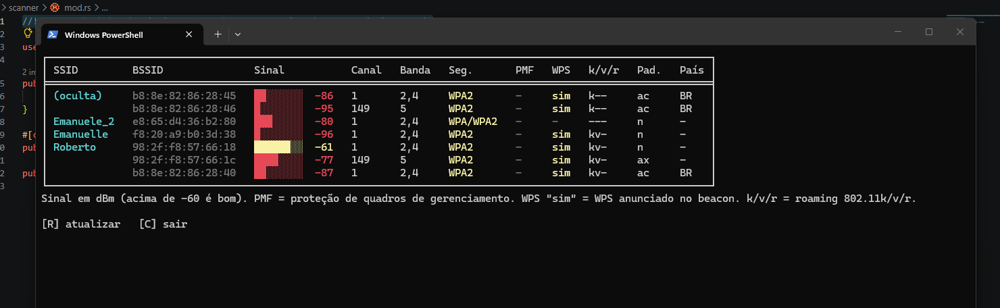

# wifi-scanner

Scanner de redes Wi-Fi para o terminal, escrito em Rust. Ele fala direto com a **WLAN API do Windows**, lê os *Information Elements* de cada beacon e mostra tudo em uma tabela única, agrupada por SSID, com barra de sinal e cores por nível de risco.



Projeto de estudo, feito para aprender Rust, `unsafe` com FFI e o formato dos beacons 802.11.

## O que ele mostra

| Coluna | Significado |
|---|---|
| **SSID** | Nome da rede (`(oculta)` quando o AP não anuncia o nome). Os BSSIDs da mesma rede ficam agrupados. |
| **BSSID** | MAC do rádio do AP. |
| **Sinal** | RSSI real em **dBm**, direto do driver, com barra colorida (verde ≥ -60, amarelo ≥ -75, vermelho abaixo disso). |
| **Canal / Banda** | Canal e faixa (2,4 / 5 / 6 GHz), calculados a partir da frequência central. |
| **Seg.** | Segurança, deduzida dos IEs do beacon e não de texto de comando: `ABERTA`, `WEP`, `WPA`, `WPA/WPA2`, `WPA2`, `WPA2/WPA3`, `WPA3`, `WPA2-Ent`, `OWE`. |
| **PMF** | Proteção de quadros de gerenciamento (802.11w). Dificulta ataques de *deauth* forjado. |
| **WPS** | `sim` quando o AP anuncia WPS no beacon. |
| **k/v/r** | Suporte a roaming: 802.11k, 802.11v e 802.11r. `-` indica que o recurso não é anunciado. |
| **Pad.** | Padrão do Wi-Fi: `a/g`, `n` (Wi-Fi 4), `ac` (Wi-Fi 5) ou `ax` (Wi-Fi 6). |
| **País** | Código regulatório anunciado pelo AP, quando existe. |

## Requisitos

- Windows 10 ou 11 com adaptador Wi-Fi
- [Rust](https://rustup.rs/) (via `rustup`)
- Build Tools do Visual Studio com o workload **Desktop development with C++** (o instalador do Rust avisa quando faltar)
- Serviço **WLAN AutoConfig** ativo
- No Windows 11 recente, a permissão de **localização** ligada em *Configurações > Privacidade e segurança > Localização*, senão o scan pode voltar vazio

## Como usar

```powershell
git clone https://github.com/SEU_USUARIO/wifi-scanner.git
cd wifi-scanner
cargo run
```

Use o Windows Terminal ou o PowerShell moderno, porque o prompt de comando antigo estraga cores e caracteres de caixa.

| Tecla | Ação |
|---|---|
| `R` | Reescaneia e atualiza a tabela |
| `C` ou `Esc` | Sai |

### Modo demo

```powershell
cargo run -- --demo
```

Usa dados simulados (uma rede WPA2 com WPS, uma WPA3, uma aberta e uma oculta). Serve para testar a interface sem depender do hardware. Em sistemas que não são Windows, é o único modo disponível, pois a leitura real de Wi-Fi só está implementada para Windows.

## Como funciona

1. `WlanScan` pede um novo scan ao driver e o programa espera alguns segundos.
2. `WlanGetNetworkBssList` devolve, para cada BSSID, o RSSI em dBm, a frequência e os bytes crus dos Information Elements.
3. Um parser percorre os IEs (formato TLV) e extrai:
   - **RSN (ID 48):** tipos de autenticação (PSK, SAE, EAP, OWE) e flags de PMF
   - **Vendor Microsoft (ID 221):** WPA1 e WPS
   - **IDs 45, 191 e 255 (ext. 35):** capacidades HT, VHT e HE, que definem o padrão
   - **IDs 54, 70 e 127:** roaming 802.11r, k e v
   - **ID 7:** código do país
4. A interface desenha a tabela com `comfy-table` e controla o terminal com `crossterm`.

## Estrutura do projeto

```
src/
├── main.rs              # loop principal: escaneia, interpreta, desenha, espera tecla
├── domain.rs            # Risco, BssBruto (dados crus) e Ap (dados interpretados)
├── scanner/
│   ├── mod.rs           # trait Scanner
│   ├── wlan.rs          # implementação Windows (todo o unsafe fica aqui)
│   └── simulado.rs      # scanner falso para --demo e testes
├── parser/
│   ├── mod.rs           # BssBruto -> Ap, cálculo de canal e banda
│   ├── ie.rs            # iterador de Information Elements
│   └── rsn.rs           # leitura do RSN e classificação de segurança
└── ui/
    ├── tabela.rs        # tabela, barra de sinal e cores
    └── terminal.rs      # tela alternativa e leitura de teclas
```

A ideia central é o trait `Scanner`: o resto do programa não sabe de onde vêm os dados. Isso permite trocar a fonte (Windows, simulada, e no futuro Linux ou arquivo) sem mexer no parser nem na interface.

## Testes

```powershell
cargo test
```

Cobrem o iterador de IEs, a leitura do RSN, a classificação de segurança, o cálculo de canal e banda e o `analisar` de ponta a ponta. O parser é código puro, então os testes não precisam de Wi-Fi.

## Limitações

- A leitura real só funciona no Windows.
- O scan bloqueia por cerca de 4 segundos; teclas apertadas nesse intervalo são descartadas.
- A classificação de segurança olha o que o beacon anuncia. Ela não testa a rede e não prova que ela é segura ou insegura.
- O campo País e algumas flags dependem de o fabricante preencher o beacon.

## Ideias para o futuro

- Atualização automática com contador de "última atualização"
- Detector de mudanças (novo BSSID, segurança ou canal alterados para um SSID conhecido, sinal clássico de *evil twin*)
- Fabricante do AP pelo OUI do MAC
- Exportar para JSON ou CSV
- Scanner para Linux via `nl80211`
